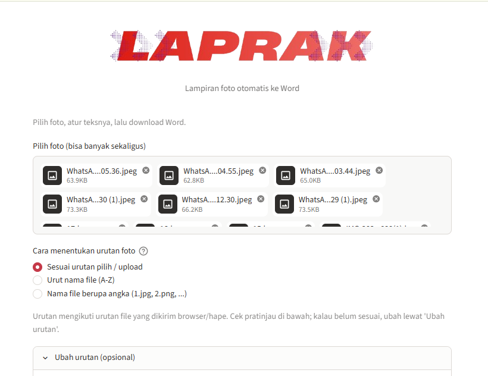
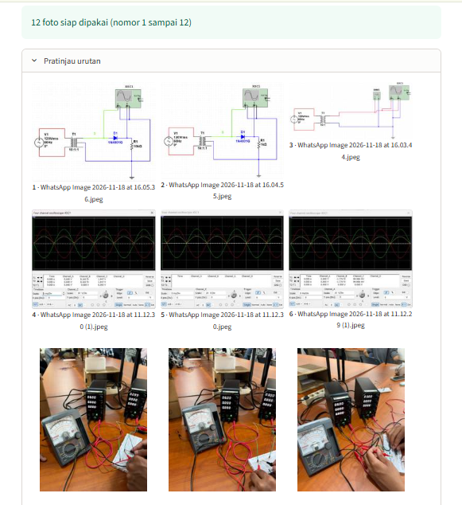
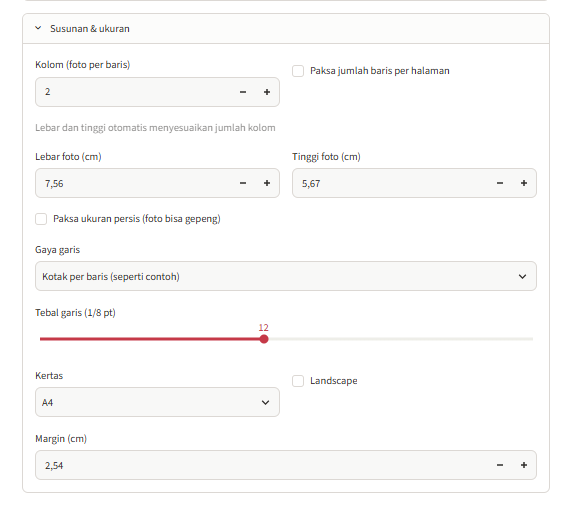

# LampirGen

Aplikasi web untuk menyusun foto lampiran laporan praktikum ke dokumen Word (.docx) secara otomatis, langsung dari browser.

**Coba langsung:** https://lampiran-rivan.streamlit.app/

> Aplikasi berjalan di hosting gratis Streamlit, jadi bisa "tertidur" kalau lama tidak dipakai. Kalau muncul tombol untuk membangunkannya, klik saja dan tunggu beberapa saat.

## Tampilan

<p align="center">
  
</p>

<p align="center">
  
</p>

<p align="center">
  
</p>

## Latar belakang

Menyusun foto lampiran laprak di Word memakan waktu dan cukup ribet, terutama bagi yang kurang lincah memakai Word. LampirGen dibuat untuk mempersingkat proses itu, dan bisa dipakai dari HP ketika sedang tidak membawa laptop.

## Fitur

- Upload banyak foto sekaligus (JPG, PNG, BMP, GIF, TIFF, WebP)
- Tiga cara menentukan urutan foto: sesuai urutan upload, urut nama file (A-Z), atau nama file berupa angka (1.jpg, 2.png, ...)
- Pratinjau urutan foto, dengan tabel untuk mengubah urutan secara manual
- Pengaturan layout: jumlah kolom, ukuran foto, jenis kertas (A4 atau Letter), orientasi, margin, dan gaya garis
- Teks atas dan bawah untuk tiap foto, ditulis dengan format `nomor: teks`
- Foto dimasukkan ke Word tanpa dikompres ulang

## Cara pakai

1. Buka aplikasi dan upload foto.
2. Pilih cara menentukan urutan foto.
3. Atur susunan dan teks keterangan (opsional).
4. Klik **Buat Word**, lalu download hasilnya.

## Menjalankan di komputer sendiri

Pastikan Python sudah terpasang, lalu jalankan:

```bash
git clone https://github.com/rivanfathur-rgb/lampir.git
cd lampir
pip install -r requirements.txt
streamlit run app.py
```

Pustaka yang dipasang: `streamlit`, `python-docx`, dan `pillow`.

## Teknologi

Python, Streamlit, python-docx, Pillow, pandas

## Struktur

- `app.py`: tampilan dan alur aplikasi web
- `lampiran_core.py`: logika pembuatan dokumen Word

## Pembuat

Muhammad Rivan Fathurozin ([@rivanfathur-rgb](https://github.com/rivanfathur-rgb))
